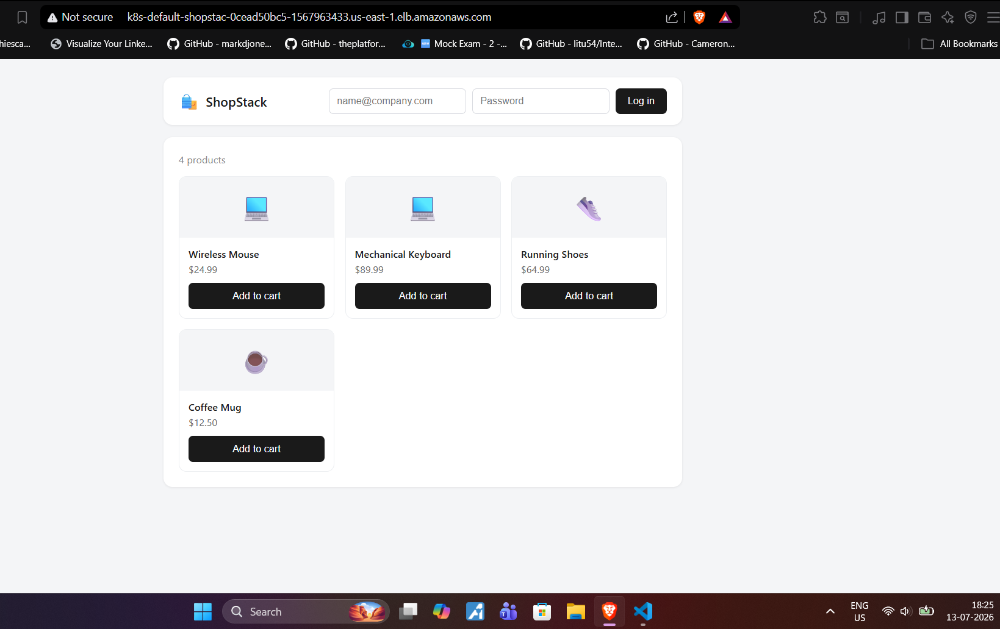
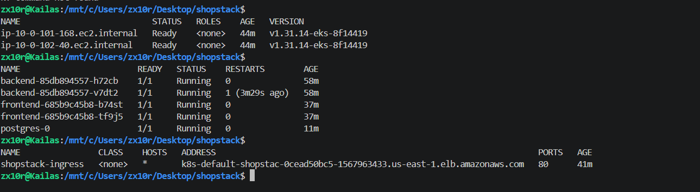

# ShopStack

A 3-tier e-commerce application built to demonstrate production infrastructure
patterns: Infrastructure as Code, container orchestration, and CI/CD — built
end to end as a hands-on project alongside CKA and Terraform Associate
certification prep.

## Architecture

```
                    AWS ALB (Ingress Controller)
                              |
              +---------------+---------------+
              |                               |
          /api/* routes                  /* routes
              |                               |
      +-------v-------+             +---------v--------+
      | Backend (Node) |             | Frontend (React)  |
      | Express + JWT  |             | served via Nginx  |
      | 2 replicas     |             | 2 replicas         |
      +-------+--------+             +--------------------+
              |
      +-------v---------+
      | Postgres         |
      | StatefulSet      |
      | 5Gi PVC          |
      +------------------+
```

## Why these choices

- **Postgres as a StatefulSet, not a Deployment** — stateful data needs stable
  network identity and persistent storage across restarts, which is what
  StatefulSet + PVC provides. RDS would be the production alternative; this
  project runs Postgres in-cluster to keep the whole stack demonstrable within
  EKS itself.
- **JWT auth over sessions** — stateless auth means any backend replica can
  validate a request without shared session storage, which matters once you're
  running multiple replicas behind a Service.
- **Separate ConfigMap and Secret** — DB host/port/user are not sensitive and
  live in a ConfigMap; DB password and JWT signing key are pulled from a
  Kubernetes Secret. Mirrors how you'd separate these in any real deployment.
- **ALB Ingress with path-based routing** — `/api/*` goes to the backend
  Service, everything else to the frontend, mirroring how a real reverse
  proxy setup would route traffic without needing a separate load balancer
  per service.
- **Multi-stage Docker builds** — frontend build stage produces static assets
  copied into a lightweight Nginx image; backend excludes devDependencies from
  the final image. Both run as non-root users.

## Tech Stack

| Layer | Technology |
|---|---|
| Frontend | React 18, Vite |
| Backend | Node.js, Express, JWT, bcrypt |
| Database | PostgreSQL 16 (StatefulSet) |
| Infra | AWS EKS, VPC, IAM (Terraform) |
| CI/CD | GitHub Actions |
| Packaging | Docker, Helm |

## Local Development

```bash
docker-compose up --build
```

- Frontend: http://localhost:3000
- Backend: http://localhost:8080
- Health check: http://localhost:8080/health

## AWS Deployment

### 1. Provision infrastructure

```bash
cd terraform

# One-time: create S3 bucket for remote state
aws s3api create-bucket --bucket <your-unique-bucket-name> --region us-east-1
aws s3api put-bucket-versioning --bucket <your-unique-bucket-name> \
  --versioning-configuration Status=Enabled

terraform init -backend-config="bucket=<your-unique-bucket-name>"
terraform plan
terraform apply
```

### 2. Connect kubectl

```bash
aws eks update-kubeconfig --name shopstack-eks --region us-east-1
kubectl get nodes
```

### 3. Install the AWS Load Balancer Controller

Required for the Ingress resource to actually provision an ALB.

```bash
helm repo add eks https://aws.github.io/eks-charts
helm repo update
helm install aws-load-balancer-controller eks/aws-load-balancer-controller \
  -n kube-system \
  --set clusterName=shopstack-eks \
  --set serviceAccount.create=true
```

### 4. Build and push images to ECR

```bash
ACCOUNT_ID=$(aws sts get-caller-identity --query Account --output text)
REGION=us-east-1
ECR_URI=${ACCOUNT_ID}.dkr.ecr.${REGION}.amazonaws.com

aws ecr create-repository --repository-name shopstack-backend --region $REGION
aws ecr create-repository --repository-name shopstack-frontend --region $REGION

aws ecr get-login-password --region $REGION | docker login --username AWS --password-stdin $ECR_URI

docker build -t $ECR_URI/shopstack-backend:v1 ./backend
docker push $ECR_URI/shopstack-backend:v1

docker build -t $ECR_URI/shopstack-frontend:v1 ./frontend
docker push $ECR_URI/shopstack-frontend:v1
```

### 5. Deploy with Helm

```bash
helm upgrade --install shopstack ./helm/shopstack \
  --set backend.image=$ECR_URI/shopstack-backend:v1 \
  --set frontend.image=$ECR_URI/shopstack-frontend:v1 \
  --set postgres.password=<choose-a-password> \
  --set jwtSecret=<choose-a-secret>
```

### 6. Get the Ingress URL

```bash
kubectl get ingress
# use the ADDRESS column - takes a few minutes to provision
```

## CI/CD

`.github/workflows/deploy.yaml` runs on every push to `main`:
1. **Test** — installs dependencies, builds frontend to catch build errors
2. **Build & Push** — builds Docker images, pushes to ECR tagged with commit SHA
3. **Deploy** — updates kubeconfig, runs `helm upgrade` against the live cluster

Required GitHub repo secrets: `AWS_ACCESS_KEY_ID`, `AWS_SECRET_ACCESS_KEY`,
`AWS_REGION`, `ECR_REGISTRY`, `EKS_CLUSTER_NAME`, `DB_PASSWORD`, `JWT_SECRET`.

## Tear down

```bash
helm uninstall shopstack
cd terraform && terraform destroy
```

**Warning:** this deletes the EKS cluster, VPC, and all associated resources.

## Screenshots

**App running live on AWS (not localhost) — full storefront with login and product grid:**


**EKS nodes, pods, and Ingress all healthy:**

